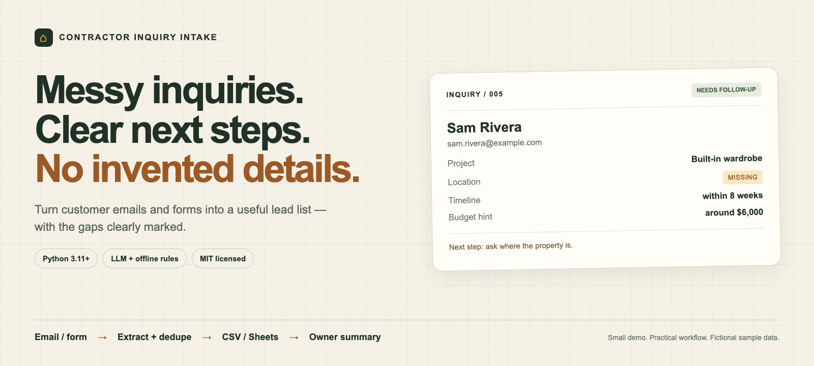

<p align="center"></p>

<p align="center">
  <a href="https://github.com/kks0488/contractor-inquiry-intake/actions/workflows/ci.yml"></a>
  
  <a href="LICENSE"></a>
  
</p>

<p align="center"><strong>English</strong> · <a href="README.ko.md">한국어</a></p>

<h2 align="center">A useful lead list starts with knowing what is missing.</h2>

Customer emails rarely arrive in a perfect format. This small demo turns saved contractor, carpentry, and renovation inquiries into a lead list: contact, project, location, timing, budget hint, and **MISSING information to ask about next**.

<table>
  <tr><td width="50%"><strong>Keep the customer's words</strong><br>Values must appear in the inquiry. Unsupported LLM guesses are discarded; unknowns stay empty.</td><td><strong>Give the owner a next step</strong><br>Flag a missing location, callback method, scope, timeline, or budget instead of guessing.</td></tr>
  <tr><td><strong>Skip repeat submissions</strong><br>Content fingerprints and a locked CSV ledger prevent repeat rows across runs.</td><td><strong>Start small, connect later</strong><br>Local CSV and console work immediately. Google Sheets and Slack are optional.</td></tr>
</table>

```text
Saved email / web form JSON → extract + evidence check → dedupe
                                                        ↓
                                    local CSV → optional Google Sheet
                                                        ↓
                                    console → optional Slack summary
```

## Quick start — no key required

Python 3.11 or newer. From a terminal:

```sh
git clone https://github.com/kks0488/contractor-inquiry-intake.git
cd contractor-inquiry-intake
python3.11 -m venv .venv
source .venv/bin/activate
python -m pip install -e .

contractor-intake samples --rules-only --local-only \
  --csv output/demo.csv --table output/demo.md
```

The ten fictional inputs produce **9 new rows, 1 duplicate, 0 errors**. Run the same command again: **0 new rows, 10 duplicates**. The CSV keeps the original nine rows. `python -m contractor_inquiry_intake` is an equivalent entry point.

`--rules-only` disables LLM calls even if a key is set. `--local-only` disables Sheets and Slack. Without a key, extraction automatically uses deterministic rules. Runtime dependencies are HTTPX and filelock; no database or web server is required.

## A real LLM run on fictional inquiries

Recorded on **2026-10-16** using Nebius Token Factory, `nvidia/Nemotron-3_5-Lightning`, and the checked-in samples. Nine unique inquiries were sent to the model; the tenth was skipped before an API call. The table below is generated by the CLI, with no manually filled customer fields.

<!-- SAMPLE_OUTPUT_START -->

| Source | Status | Contact | Project | Location | Timeline | Budget hint | MISSING | Extractor |
| --- | --- | --- | --- | --- | --- | --- | --- | --- |
| 01_kitchen.txt | ADDED | Maya Ellis / maya.ellis@example.com / 202-555-0101 | Kitchen renovation | Cedar Hollow, OR | next month | $18,000-$22,000 | — | llm |
| 02_bookshelves.json | ADDED | Jonah Reed / jonah.reed@example.com | custom bookshelves | Maple Crossing, WA | within 6 weeks | $4,500 | — | llm |
| 03_deck_messy.txt | ADDED | Theo Park / 202.555.0103 | deck repair | Birch Cove, ME | ASAP | $2k max | — | llm |
| 04_bathroom.txt | ADDED | Elena Moss / elena.moss@example.com | Bathroom remodel | Pine Harbor, VT | before December 2026 | MISSING | budget_hint | llm |
| 05_missing_location.txt | ADDED | Sam Rivera / sam.rivera@example.com | built-in wardrobe with sliding doors | MISSING | within 8 weeks | around $6,000 | location | llm |
| 06_flooring.json | ADDED | Priya Lane / 202-555-0106 | flooring installation | Willow Bend, CO | MISSING | $9,000 | timeline | llm |
| 07_basement_messy.txt | ADDED | Owen Vale / owen.vale@example.com | basement finishing | Ash Grove, MN | next month | 15000 USD | — | llm |
| 08_door_no_contact.json | ADDED | Avery Stone | door repair | Elm Ridge, NC | next week | $500 | contact | llm |
| 09_vague_messy.txt | ADDED | Riley Finch / riley.finch@example.com | MISSING | Fox Hollow, PA | MISSING | MISSING | project_type, timeline, budget_hint | llm |
| 10_kitchen_duplicate.txt | DUPLICATE | — | — | — | — | — | — | — |

<!-- SAMPLE_OUTPUT_END -->

All people and inquiries in `samples/` are fictional. Email contacts use `example.com`, and phone contacts use the fictional 555-01xx range. Samples include messy shorthand, a missing location, unknown budget/timing, missing contact, vague scope, and one exact duplicate. Sheets and Slack are tested with mocks; the live sample run uses local CSV and console only.

## Use an OpenAI-compatible LLM

The default [Nebius endpoint](https://docs.tokenfactory.nebius.com/quickstart) is `https://api.tokenfactory.nebius.com/v1`, with model `nvidia/Nemotron-3_5-Lightning`. Override any of the three environment variables:

```sh
export LLM_BASE_URL=https://api.tokenfactory.nebius.com/v1
export LLM_MODEL=nvidia/Nemotron-3_5-Lightning
# Set LLM_API_KEY through your shell or secret manager, then:
contractor-intake samples --local-only --csv output/llm.csv --table output/llm.md
```

For a key already stored in macOS Keychain:

```sh
LLM_API_KEY="$(security find-generic-password -s nebius-token-factory -a kks0488 -w)" \
  contractor-intake samples --local-only --csv output/llm.csv
```

The application does not write the key or load `.env` files. [`.env.example`](.env.example) lists supported settings. When a key is present, the inquiry text is sent to the configured endpoint. With rules only, extraction is local.

The extractor uses [Chat Completions JSON mode](https://developers.openai.com/api/reference/resources/chat/subresources/completions/methods/create), validates the seven-key response, and accepts only case/whitespace-equivalent spans present in the source. Each accepted field has an `evidence` quote in the CSV. Explicit form values take precedence. The default Nemotron model receives `chat_template_kwargs: {"enable_thinking": false}` so its output budget goes to JSON; this setting was verified with the live endpoint. Other model names receive the generic request only.

Timeouts, API failures, invalid JSON/schema, and truncated completions use `rules-fallback`, recorded in the CSV. There are no automatic paid retries. The fallback recognizes common English project phrases, explicit `Location:`/`Timeline:`/`Budget:` labels, email, US-style phone numbers, and a few timing/budget patterns. It intentionally leaves unfamiliar phrasing missing.

## Your own input

Pass one file or a directory. Directories are read in filename order, without recursion. Supported files are UTF-8 `.txt`, plain-text `.eml`, and one web form object per `.json`. MIME attachments, HTML email decoding, mailbox polling, and an HTTP form server are outside this demo.

```json
{
  "name": "Jonah Reed",
  "email": "jonah.reed@example.com",
  "phone": null,
  "project_type": "custom bookshelves",
  "location": "Maple Crossing, WA",
  "timeline": "within 6 weeks",
  "budget_hint": "$4,500",
  "message": "Two alcoves beside the fireplace."
}
```

All fields are optional strings or `null`. Empty/unknown values stay missing; unsupported keys are ignored. `message` supplies free text. Malformed files are reported as `ERROR`, other files continue, and the CLI exits with code 1 if any input failed.

```sh
contractor-intake path/to/inquiry.json --csv data/inquiries.csv
contractor-intake path/to/email.txt --rules-only --local-only
```

| Output | Meaning |
| --- | --- |
| `name`, `email`, `phone` | Contact details copied from the inquiry; a name alone is not a callback method. |
| `project_type`, `location`, `timeline`, `budget_hint` | Customer wording, with no address completion, date calculation, or invented budget. |
| `missing` | `contact` if neither email nor phone exists, plus any missing project, location, timeline, or budget hint. Name is optional. |
| `evidence`, `extractor`, `warnings` | Source quotes, `rules` / `llm` / `rules-fallback`, and rejected fields or fallback status. |
| `inquiry_id`, `source`, `received_at` | SHA-256 content identity, input filename, and UTC intake time. |

Deduplication normalizes Unicode, case, and whitespace; JSON key order is irrelevant. The CSV path defines the dedupe scope. Different wording, an email forward, or changed project details counts as a new inquiry; there is no fuzzy person matching. Deleting or switching the ledger resets that history. A local file lock protects append operations. CSV cells that could become spreadsheet formulas are prefixed with an apostrophe; the evidence still preserves the original wording.

## Optional Google Sheets

The CSV is always written first and remains the local record. With Sheets enabled, new rows are also appended through the [Google Sheets API](https://developers.google.com/workspace/sheets/api/reference/rest/v4/spreadsheets.values/append), using a service account and `valueInputOption=RAW`.

1. Enable the Google Sheets API in your Google Cloud project and create a service account. Keep its JSON credential **outside this repository**.
2. Create an `Inquiries` tab in a spreadsheet. Share the spreadsheet with the credential's `client_email` as Editor.
3. Paste this header into row 1, in columns A–N:

```text
inquiry_id,source,name,email,phone,project_type,location,timeline,budget_hint,missing,extractor,evidence,warnings,received_at
```

```sh
python -m pip install -e '.[sheets]'
export GOOGLE_APPLICATION_CREDENTIALS=/absolute/path/outside/repo/credentials.json
export GOOGLE_SHEET_ID=your-spreadsheet-id
export GOOGLE_SHEET_RANGE='Inquiries!A:N'
contractor-intake path/to/new-inquiries --csv data/inquiries.csv
```

The header is shown comma-separated; paste with **Split text to columns → Comma**, or copy the header row from the local CSV. The app does not create a spreadsheet or its tab. On authentication, dependency, or network failure, it reports that the rows remain in CSV. Re-running a captured inquiry does not resend it to Sheets: import the retained CSV manually if a mirror write failed. This demo does not provide distributed exactly-once delivery or automatic Sheet reconciliation.

## Owner notifications

Every run prints a deterministic owner summary, including contact, project, location, timing, budget, and what to ask next. Set `SLACK_WEBHOOK_URL` in your environment to also send one [Slack incoming webhook](https://docs.slack.dev/messaging/sending-messages-using-incoming-webhooks/) summary when new rows were saved. Customer text uses Slack `plain_text`; failures leave the CSV intact. Slack messages are capped at 2,900 characters; the console contains the full summary. No customer replies are sent.

## How this maps to a real business

| In a small contractor's day | What this demo does |
| --- | --- |
| Emails and website requests arrive while the owner is on site. | A worker can save each message/form as a file and call the CLI. The mail/form connector is your integration point. |
| Someone needs to copy useful details into a lead list. | Structured rows go into CSV and optionally the shared Google Sheet. |
| An inquiry lacks a property location or budget. | `MISSING` tells the owner what to ask before a site visit or estimate. |
| A customer clicks submit twice. | The same normalized content creates one row and one new-lead notification entry. |
| The owner checks messages at the end of the day. | Console or Slack lists the new work and the gaps. |

A budget hint is the customer's stated range, not a contractor estimate. The business owner reviews scope, service area, scheduling, and pricing. Literal evidence prevents unsupported synthesis, but does not prove a field was classified correctly: review the inquiry before quoting. For a production workflow, add the inbound connector, access controls, and a retry/reconciliation queue appropriate to the business. Local records include contact data and evidence; `data/`, `output/`, environment files, and common credential filenames are gitignored.

## Tests and development

```sh
python -m pip install -e '.[dev,sheets]'
pytest -q
ruff check .
ruff format --check .
```

Tests cover extraction, missing information, unknown placeholders, evidence rejection, API failures, normalized and persistent dedupe, concurrent CSV appends, formula protection, malformed inputs, CLI output, and mocked Sheets/Slack calls. CI runs on Python 3.11 and 3.13, with an offline sample run and a Gitleaks job. Tests need no API key or external account. Before the first public push, the complete Git history was scanned with Gitleaks.

The [banner HTML](assets/banner.html) is checked in with its [Playwright renderer](assets/render_banner.py). To regenerate with an existing Playwright environment (not needed to run intake):

```sh
python -m pip install playwright
python -m playwright install chromium
python assets/render_banner.py
```

The published 1600 × 720 banner was rendered with the existing local Playwright Python environment. Contributions welcome: include fictional fixtures and tests, and keep both READMEs in sync.

## License

[MIT](LICENSE) © 2026 Kyoungsoo Kim.
